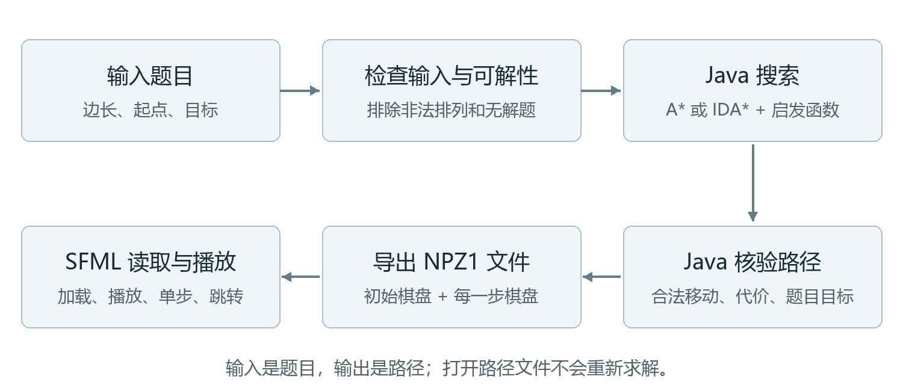
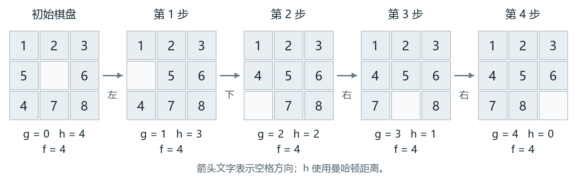
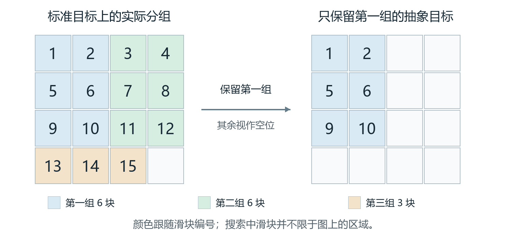

# 实验一完整解题思路

这份文稿供组内理解和交接使用。即使没有参与代码编写，也可以从头读懂：题目怎样变成一个搜索问题，程序怎样找到最短解，为什么需要逐步优化，以及实验数据能够说明什么。上台时仍使用逐页讲稿；这里保留推导、例子和实现上的条件，方便把讲稿背后的原因弄清楚。

我们完成的过程是：读取初始棋盘和目标棋盘，先判断两者能否互相到达，再用 A* 或 IDA* 搜索最短移动序列。优先队列让 A* 更快管理待搜索状态；启发函数帮助两个算法减少无用搜索；PDB 为困难十五数码提供更有力的估计。找到路径后，Java 独立核验每一步，再导出文件，由 C++ SFML 程序播放。

阅读时可以先沿着第 1 至 6 节理解基本搜索，再读第 7 至 10 节理解优化。第 11 至 14 节解释结果、验证和演示，第 15 至 17 节提供操作、源码入口与自查问题。文中的“四步小题”是专门选的教学例子；课程实测结果单独标明，不把示意计算当作实验记录。

## 1 老师要求我们完成什么

老师给出的《NPuzzle求解的要求》包含代码约束、四个实施阶段和研究报告要求。代码约束是使用课程 Java 框架，保留已有框架代码，并补充必要注释。我们通过新增问题模型、队列、启发函数和搜索器接入框架；仓库保存了 26 个既有 Java 文件的散列基线，用于核查这些文件是否被改动。

八数码是 3×3 棋盘，放 8 个编号滑块和一个空格；十五数码是 4×4 棋盘，放 15 个编号滑块和一个空格。所谓“解题”，就是只用相邻滑块与空格交换，将初始排列变成指定目标，并让移动次数尽可能少。

| 阶段 | 要解决的问题 | 我们的对应做法 |
| --- | --- | --- |
| 第一阶段 | 两道指定八数码在 1 秒内求解，使用 A* 和优先队列 | 接入课程 A*，实现索引二叉堆；分别测试错位数与曼哈顿距离 |
| 第二阶段 | 对十五数码使用 IDA*；建议使用 Zobrist 哈希 | 实现按估计总代价逐轮加深的搜索、逆动作剪枝和有界置换表；状态采用完整 64 位编码 |
| 第三阶段 | 使用不相交模式与模式数据库，在 1 分钟内求解指定困难实例 | 实现 6+6+3 放松 PDB，与 IDA* 配合；分别记录建库准备、搜索和总耗时 |
| 第四阶段 | 展示解路径，推荐 SFML | Java 导出逐帧棋盘，SFML 读取并提供播放、单步和跳转 |

要求文件里的两道八数码，对应 `resources/problems3.txt` 第 2、3 题；倒序十五数码对应第 10 题。课程数据中的题号和棋盘是一一对应的，不需要凭截图重新录入。

老师还要求比较三种启发函数、比较 A* 与 IDA*、解释数据结构和算法改进，并用详细实验数据分析优缺点。因此，“程序找到了一条路径”只是其中一部分。我们还需要证明路径合法、说明最优性依据，并用相同条件下的测量回答“改进有没有用”。

要求中的 Zobrist 是建议。本项目没有把实现写成 Zobrist，而是利用棋盘最多只有 16 格的特点，采用能完整保存状态的 64 位编码。第 3 节会解释这个选择。正式研究报告与课堂 PPT 的用途也不同：研究报告要求介绍问题，老师后来对 8 分钟汇报明确要求省去项目背景。队友需要理解背景，但上台不必逐段讲这份文稿。

## 2 把整个程序连起来看



输入文件中的一行包含三部分：棋盘边长、初始排列、目标排列。比如边长为 3，后面先读 9 个初始数字，再读 9 个目标数字。0 表示空格。程序先检查数字有没有重复、缺失或越界，然后判断这道题有没有解。

进入搜索时，需要同时确定两个选择：用什么算法安排搜索顺序，以及用什么启发函数估计剩余距离。A* 和 IDA* 是搜索算法；错位数、曼哈顿距离和 PDB 是启发函数。它们可以组合使用，例如 A* 加曼哈顿、A* 加 PDB、IDA* 加曼哈顿、IDA* 加 PDB。PDB 本身不负责把整道题从头走到尾。

搜索成功后，得到一串动作及其经过的棋盘。Java 再检查这些棋盘是否真的连续、每一步是否只移动一个相邻滑块、最终是否到达输入指定的目标。通过检查后，才将路径导出为 `.npz`。SFML 不需要重新搜索，只需按文件里的棋盘顺序播放。

这条处理流程也解释了几个常见误会：PPT 上的性能数据来自 Java 求解；界面上的动画来自 SFML 播放；“打开路径文件”加载的是已经求出的路径。换一个文件可以展示另一个案例，但不能把文件切换说成界面现场求解。

## 3 怎样把棋盘交给程序

### 3.1 状态 动作 代价和目标

搜索中的“状态”是一整盘棋的排列。某个滑块的位置相同，不代表状态相同；必须整盘一致，才是同一状态。我们按从左到右、从上到下的顺序，将棋盘展开成一维序列。

下面这道四步小题贯穿后面的解释。它的初始排列是 `1 2 3 5 0 6 4 7 8`，目标排列是 `1 2 3 4 5 6 7 8 0`。

```text
初始棋盘             目标棋盘
1  2  3              1  2  3
5  0  6              4  5  6
4  7  8              7  8  0
```

一个动作让空格与上下左右的某个相邻滑块交换。空格在边缘时，越界方向无效；不能斜着换，也不能隔着一格换。每次合法交换的代价为 1，因此最小总代价就是最少移动次数。

代码里的 `UP`、`DOWN`、`LEFT`、`RIGHT` 指空格方向。以小题第一步为例，空格向左，滑块 5 就向右。SFML 用滑块方向描述动作，因此“空格左移”和“滑块 5 向右”说的是同一步。

### 3.2 为什么能把整盘棋装进一个整数

十五数码的格子值在 0 到 15 之间，每个数用 4 个二进制位就能表示。16 格一共需要 16×4＝64 位，刚好能装入 Java 的 `long`。代码将第 i 格存到从第 4i 位开始的四个位中。

这相当于给每个位置留一个固定的小格子。交换空格与滑块时，只要改变对应的两段四位数据，其余位置保持不变。不用将棋盘转成一长串字符串，也不用每次比较 16 个独立对象。

这里要区分“状态编码”和“哈希”。完整编码保存了整盘信息；哈希将编码混合后，用来找到哈希表中的槽位。不同棋盘可能落入同一个槽位，所以槽位相同还不够，必须再比较完整状态键。普通棋盘对象比较时还会检查棋盘大小；一次 IDA* 搜索的棋盘大小固定。

Zobrist 通常将若干预生成随机数异或得到状态指纹，适合很多棋类。本题棋盘小，可以直接存下全部状态，所以我们选择完整编码。不能因为实现用了异或操作，就把它叫作 Zobrist。

### 3.3 为什么公开棋盘对象保持不可变

`PuzzleBoard` 创建后内容不再改变，执行一步会返回新的棋盘对象，向外提供数组时也返回新数组。这样，一个已经放入 Open 表或 Closed 表的状态，不会被另一个操作悄悄改掉，导致查重和路径记录出错。

IDA* 的内部搜索另有一份可修改数组，用于快速交换和回退。它是搜索器内部的工作区；每次递归返回时恢复原值。不可变的外部状态和可回退的内部工作数组承担不同职责，并不矛盾。

## 4 搜索之前为什么要判断有解无解

有些排列无论怎么滑动，都无法变成给定目标。如果直接开始搜索，程序可能花很长时间遍历状态，最后仍找不到答案。我们先比较初始棋盘与目标棋盘的奇偶不变量，排除这种情况。

“逆序对”可以这样数：按行读出数字，忽略 0；如果左边一个数比右边一个数大，这一对就是逆序。例如 `1 3 2` 只有 3 和 2 这一对，所以逆序数为 1。

边长为奇数时，比较起点和目标的逆序数奇偶性。边长为偶数时，比较“逆序数＋空格从下向上数的行号”的奇偶性，最底行为第 1 行。两端一致，才属于同一个可达集合。

为什么这个规则和移动有关？水平交换空格不会改变其他数字的相对顺序。空格竖直移动时，被交换的数字会越过 n−1 个数字，其中 n 是棋盘边长。n 为奇数时，n−1 为偶数，逆序奇偶性不变；n 为偶数时，逆序奇偶性翻转，而空格所在行的奇偶性也翻转，两者相加的奇偶性仍不变。

对四步小题，忽略 0 后是 `1 2 3 5 6 4 7 8`，逆序对是 5 与 4、6 与 4，共 2 对，为偶数；标准目标有 0 对，也为偶数，因此可解。若把标准八数码目标中的 1、2 交换，其逆序数变成奇数，就无法滑回标准目标。

对本项目的 2×2、3×3、4×4 方形棋盘，这个条件既是必要条件，也是充分条件，即两端奇偶量相同就可解。上面的移动分析解释了不变量为何保持不变；完整的充分性证明不在这里展开，代码另外用 2×2 全部起终点组合核对判定结果。

程序比较的是起点与实际输入目标，不是永远认定“偶数就可解”。这使得非标准目标也能正确处理。`UNSOLVABLE` 表示经过判断确实无解；`TIMEOUT` 或 `NODE_LIMIT` 表示本次搜索资源用完，两者不能混为一谈。

## 5 A* 怎样选择下一步搜索谁

### 5.1 三个量各自表示什么

A* 给每个候选节点计算 `f＝g＋h`。g 是从起点走到当前节点已经付出的代价，在本实验中就是已经走过的步数；h 是从当前棋盘到目标至少还需要多少步的估计；f 是经由这个节点到达目标的估计总代价。

例如某节点已经走了 6 步，估计至少还要 10 步，那么 f＝16。另一个节点已经走了 9 步，估计还要 3 步，f＝12，A* 会优先处理后者。只看 h 会忽略前面走了多少冤枉路；只看 g 则没有利用目标方向的信息。

h 不能被理解为“答案的预测值一定正确”。它是搜索使用的下界。估计 21 步，最终最短解 31 步，完全可能正确；估计比实际最短距离大，反而会破坏本项目依赖的最优性条件。

### 5.2 Open 表与 Closed 表

“状态”只表示棋盘排列；“节点”还记录通过哪条路线到达它，包括父节点、最后一步动作和已经付出的 g。两个节点可以对应同一棋盘，但到达路线不同。父节点记录的是上一步从哪里来，找到目标后顺着这些记录往回找，再反转顺序，就能恢复完整路径。

Open 表保存已经发现、等待处理的节点。Closed 表保存已经展开过的状态。一次“展开”是取出一个节点，尝试它的合法动作，产生后继节点；不是指界面上播放了一步。

A* 每次从 Open 表取 f 最小的节点。若它是目标，就沿父节点记录恢复路径；否则把它加入 Closed，并生成后继。后继若已经在 Closed 中，本课程搜索器跳过它；若在 Open 中，新的路径更便宜时更新其记录；若从未见过，则放入 Open。

同一棋盘可能由多条路线到达。假设原来走 10 步到达棋盘 X，现在发现只需 8 步，X 后面的选择没有改变，但前半程省了两步，所以应保留更小的 g。这里比较的是“到达同一状态的路线”，不能因为两个不同棋盘的 f 一样就合并它们。

### 5.3 手算四步小题

这里先用曼哈顿距离，也就是把每块非空滑块与目标位置相差的横向格数和纵向格数全部相加，暂不考虑阻挡。初始状态中 4、5、7、8 各差一格，h＝4；还没移动，g＝0，所以 f＝4。空格在正中，有四个合法方向。

| 空格动作 | 交换的滑块 | 新的 g | 新的 h | 新的 f |
| --- | --- | --- | --- | --- |
| 向上 | 2 | 1 | 5 | 6 |
| 向下 | 7 | 1 | 5 | 6 |
| 向左 | 5 | 1 | 3 | 4 |
| 向右 | 6 | 1 | 5 | 6 |

因此首先取出空格向左的分支。继续搜索后，空格依次向下、向右、向右，经过下面五个棋盘。



这条路径上的 g 依次为 0、1、2、3、4，h 依次为 4、3、2、1、0，f 始终为 4。先前那些 f＝6 的候选仍在 Open 中，但在找到目标前不需要优先展开它们。这也说明 A* 不是每一步只保留一个方向的贪心移动：其他候选并未凭空丢弃。

我们已经找到一条 4 步合法路径，而初始 h＝4 又说明不可能少于 4 步，所以这道小题的最短解就是 4 步。课程难题中 h 通常小于真实距离，A* 就需要多展开一些候选，才能确定最终解。

### 5.4 为什么本项目强调一致性

可采纳性要求 h 不超过真实最短剩余距离。一致性还要求，对任意相邻状态 s 和 s′，满足 `h(s) ≤ 1＋h(s′)`。因为一条边代价为 1，这意味着估计值不会在走一步后不合理地大幅下降。

沿一条搜索路径，如果 g 增加 1，而 h 最多减少 1，那么 f 不会下降。使用一致启发函数时，A* 按最小 f 展开，一个状态首次出队时即可确定其最短到达代价，因而可以安全地放入 Closed。

课程提供的搜索器不会重新打开 Closed 状态。因此，我们的表述是“采用一致启发函数，目标首次出队时得到最优解”。不能只说“h 不高估就行”而省去这一实现条件，也不能把“首次生成目标”和“首次取出目标”混为一谈。

## 6 三种启发函数分别知道多少信息

### 6.1 错位滑块数

错位数只问：有多少个非空滑块不在自己的目标位置？每块错位滑块至少要移动一次，所以这个数不会超过实际需要的总步数。0 不参与计数，因为一次交换已经按滑块计过一次。

四步小题中有 4 块错位，因此估计为 4。但如果某块距目标很远，错位数仍只计 1；它没有使用“差了几格”的信息。这种估计便宜、直观，也容易偏低。

### 6.2 曼哈顿距离

对每个非空滑块，分别算当前位置与目标位置的行差绝对值、列差绝对值，再把两者相加。最后对全部滑块求和。

以课程第 3 题为例，初始棋盘如下；行列均从 1 开始计数。

```text
8  6  7
2  5  4
3  0  1
```

| 滑块 | 当前位置 | 目标位置 | 行差加列差 |
| --- | --- | --- | --- |
| 1 | 第 3 行第 3 列 | 第 1 行第 1 列 | 4 |
| 2 | 第 2 行第 1 列 | 第 1 行第 2 列 | 2 |
| 3 | 第 3 行第 1 列 | 第 1 行第 3 列 | 4 |
| 4 | 第 2 行第 3 列 | 第 2 行第 1 列 | 2 |
| 5 | 第 2 行第 2 列 | 第 2 行第 2 列 | 0 |
| 6 | 第 1 行第 2 列 | 第 2 行第 3 列 | 2 |
| 7 | 第 1 行第 3 列 | 第 3 行第 1 列 | 4 |
| 8 | 第 1 行第 1 列 | 第 3 行第 2 列 | 3 |

总和为 4＋2＋4＋2＋0＋2＋4＋3＝21。错位数只得到 7，因为只有滑块 5 已在目标位置。这道题实际最短解为 31 步；曼哈顿的 21 比 7 提供了更接近真实距离的下界。

为什么曼哈顿仍偏低？它把每块滑块当作可以独自走最短路线，没有完全计入滑块之间的阻挡，以及为了让空格到位而进行的绕行。这些额外移动会让真实路径更长。

### 6.3 PDB 补上滑块之间的一部分约束

PDB 不再只孤立地看每一块，而是把几块放在同一个小问题里，预先算出这个小问题到目标至少需要几步。多个小问题的结果按规则组合，得到原问题的下界。

课程第 3 题的最终 PDB 启发值为 23，仍小于真实 31，但比曼哈顿 21 更强。这里“更强”指估计下界更高、仍不高估，不表示最终会走更多步，也不保证所有实例的运行时间都会变短。

八数码用 4+4 分组，十五数码用 6+6+3 分组。八数码的常驻距离数组合计 128 KiB；十五数码约 32 MiB。不能用八数码图说明估值，却把十五数码的建库时间与内存当成同一个案例的成本。

## 7 为什么要改 Open 表的数据结构

A* 不断执行四件事：放入新节点、取最优节点、查找相同状态、更新更便宜的路径。即使搜索顺序完全相同，管理这些节点的成本也可能差很多。

课程列表实现使用排序的 `ArrayList`。取第一个元素时，不用重新扫描寻找最小值，但删除头部会移动后面的元素；查找相同状态需要线性查找；插入位置可以二分定位，但真正插入仍可能搬移一段元素。因此，不能笼统说“列表每次取最小值都扫描一遍”。

我们新增 `PqFrontier`，将二叉最小堆与“状态到堆下标”的映射结合。堆保证最优节点位于堆顶；插入或弹出后，只需沿父子关系调整约 log m 层，其中 m 是 Open 大小。映射让程序找到某个状态后，可以直接更新对应堆节点，不必再从头查找。

| 操作 | 课程排序列表 | 索引二叉堆 |
| --- | --- | --- |
| 找到同一状态 | 线性查找，O(m) | 哈希映射，期望 O(1) |
| 放入新节点 | 找位置后可能移动元素，总体 O(m) | 调整堆，O(log m) |
| 弹出最优节点 | 删除头部后移动元素，O(m) | 调整堆，O(log m) |
| 更新已有节点 | 查找及重新安排可能为 O(m) | 定位后调整堆，O(log m) |

表中的 O(m) 表示工作量可能随候选数量近似成比例增长；O(log m) 增长慢得多，候选数量翻倍时，堆大致只增加一层。期望 O(1) 表示在散列分布正常时，平均查找成本不随候选数量成比例增长，不是承诺任意情况都花同样时间。

比较时还必须固定破同分规则，也就是“第一项一样时，再按什么选”。我们统一按 f 升序、g 降序、棋盘编码升序排序。否则两个实现碰到相同 f 时选择不同节点，展开数量可能变化，时间差就不再单纯反映队列结构。

课程第 3 题、A* 加曼哈顿的队列对照中，两者都展开 6,820 个节点，3 次测量的中位搜索耗时从列表约 22.3 毫秒降到堆约 7.1 毫秒。这项改进主要减少“管理每个节点的开销”。下一节及 PDB 所解决的，则还包括内存增长和搜索数量的问题。

## 8 从 A* 转向 IDA* 的原因

### 8.1 十五数码让保存候选状态变得昂贵

相对于一个给定目标，八数码可达状态为 9!÷2＝181,440；十五数码则为 16!÷2＝10,461,394,944,000。求解时不一定遍历全部状态，但这个规模差异说明，不能把八数码上能容纳的 Open、Closed 规模直接外推到十五数码。

A* 为了随时选择全局最优候选，需要保留许多待搜索节点和已访问状态。困难问题上，即使每个节点都不大，数量增长后也会占用很多内存。

IDA* 采用深度优先搜索：沿一条分支向下走，超过限制就回退，然后尝试其他分支。限制用的是 f＝g＋h。它不需要保存 A* 那样的整个 Open 表，但可能在后续轮次重复搜索前面到过的状态。

### 8.2 阈值怎样逐轮变化

第一轮阈值 T 取起点的 h。递归到某个节点时，先算 f；若 f 大于 T，就停止这个分支，并把这个超限值返回上层。若 f 不超限，再检查是否到达目标并继续尝试合法动作。

整轮没有找到目标时，把本轮所有超限 f 中最小的那个作为下一轮 T。这样不会随意跳过仍可能包含最优解的代价层，也不用机械地每次只加 1。

举一个阈值计算示意：本轮 T＝10，某节点 g＝4、h＝8，f＝12，所以该分支停止；其他被截断分支返回 14、16。下一轮阈值就是 min(12,14,16)＝12。这个例子用来说明规则，不是课程难例的运行日志。

课程第 10 题的初始 h＝52，最后找到 70 步解。因此汇报时可画“52 → … → 70”，说明省略了中间轮次。没有逐轮日志时，不应编造一串看似完整的阈值。

### 8.3 一段便于理解的流程

```text
阈值 = 初始估值
重复执行：
    从起点做一次深度优先搜索
    遇到 g + h > 阈值：返回这个超限值
    遇到目标：保存当前路径并结束
    否则：逐个尝试合法移动，搜索后撤销移动
    本轮没有找到目标：阈值改为最小超限值
```

这是教学用流程，实际代码还包括重复状态检查、资源限额和路径记录。

为什么第一次找到的解就是最短解？设真正的最优解需要 C* 步。沿着这条路径，已经走过的 g 加上剩余真实距离，恰好等于 C*；h 不高估剩余距离，所以这条路径上每个节点的 f 都不超过 C*。

当前阈值小于 C*、尚未找到解时，最优路径上至少有一个节点被阈值挡住，但它的 f 仍不超过 C*。下一轮取的是最小超限值，因此阈值不会越过 C*。等阈值达到 C*，最优路径就能完整走通；目标的 h 为 0，本轮找到的解长也不会超过 C*。在搜索完整、剪枝正确且未提前触发资源限额的条件下，首次找到的解便具有最优代价。

### 8.4 IDA* 的节省与付出

节省来自不维护庞大的 Open 表，以及可以用原地交换、回溯恢复来减少对象创建。付出是同一状态可能在不同阈值轮次中再次展开，搜索次数不一定少于 A*。

因此，“展开节点更多但运行更快”并不自相矛盾。总耗时既取决于访问多少节点，也取决于处理一个节点多贵。实验中也会出现 IDA* 节点更多且时间更长的情况，不能把某个案例的结果当作普遍排序。

## 9 IDA* 内部怎样避免白算

### 9.1 不立即撤销刚才的一步

如果刚让空格向左，下一步立刻向右，就回到了父状态，白花了两步。单位正代价的最短路径没有必要包含这种来回，所以程序直接跳过立即逆向的动作。

这种检查非常便宜，但只能消除一步往返。绕一圈后回到旧棋盘，需要另一种机制来识别。

### 9.2 记录本轮到达同一状态的最小代价

置换表保存完整状态键、到达该状态时的 g，以及轮次标记。只有“同一轮、完整状态相同、表中旧 g 不大于当前 g”全部成立，才剪掉当前到达方式。

比如本轮阈值是 26，以前用 8 步到达状态 X，现在又用 12 步到达相同 X。后面面对同一个棋盘，以前还可使用 18 步预算，现在只剩 14 步；新路线没有优势，所以不用重复展开。若现在只用了 6 步，则应更新并继续搜索。

下一轮阈值更大，原先被阈值挡住的分支可能有机会继续深入，所以不能把上一轮“见过了”直接当作本轮剪枝依据。轮次标记正是为此设置的。

### 9.3 哈希碰撞为什么不会把两个棋盘认成一个

表的容量固定，不可能为每个可能棋盘永久留一个位置。两个状态映射到同一槽位时，代码会覆盖旧记录。覆盖可能让某次本来能够进行的剪枝失效，造成多搜一些节点；但只有完整键一致才允许剪枝，因此不会仅因槽位相同就错删另一个棋盘。

默认表有 2²¹ 个槽。每个槽的原始数组数据为 8 字节状态键、2 字节深度、4 字节轮次，共 14 字节，合计约 28 MiB。这不含 Java 数组对象头等额外开销。

所以，基本 IDA* 的路径存储随搜索深度增长，但我们的完整实现还使用约 28 MiB 的置换表和 PDB。不能把“深度优先”讲成整个程序只占一条路径的内存。

### 9.4 只更新真正改变的部分

每走一步，只有一个滑块换了位置。曼哈顿距离可以减去它原来的距离，再加上新距离，不用重新遍历全部滑块。错位数同样只需检查这块移动前后是否处于目标位置。

PDB 为各组维护位置索引，移动某块时只需更新它所在组对应的索引；启用转置估值时，也维护变换后的对应索引。递归返回时执行反向更新，把棋盘与估值一并恢复。

这种增量维护降低每个节点的计算成本，但更容易出现“棋盘恢复了、估值没恢复”的错误。因此验证中专门将增量结果与完整重算结果比较，检查移动和回退后是否一致。

## 10 PDB 是怎样建出来并帮助搜索的

### 10.1 先求简单问题再用它估计难题

模式数据库是预计算的距离表，不需要数据库服务器。它回答的问题是：只考虑指定的一组滑块，在我们定义的简化规则下，至少还要移动这些滑块多少次？

十五数码将 15 个非空滑块分成互不重叠的三组。当前实际配置如下。

| 分组 | 滑块编号 | 滑块数量 |
| --- | --- | --- |
| 第一组 | 1、2、5、6、9、10 | 6 |
| 第二组 | 3、4、7、8、11、12 | 6 |
| 第三组 | 13、14、15 | 3 |



它们加起来是 15，不包括空格。6+6+3 的意思是每组滑块数量，并不是把 16 个格子完整分成三个互不相交的区域。搜索过程中，同组滑块可以分散在棋盘不同位置。

### 10.2 本项目怎样简化规则

对第一组，只记录 1、2、5、6、9、10 的位置。其他滑块和真实空格都视作可用空位。组内某块可以移动到相邻且没有被同组滑块占据的位置，移动一次的代价为 1。

先用一个只含滑块 1 的简化小组举例。假设一行局部排列是 `1 2 3`，这个抽象里 1 右侧的位置可视作空位；现实中 2 仍占着它，未必能立即这样移动。抽象故意允许更多移动，所以问题更容易，算出的最短代价可以作为原问题的下界。

多块放入同一组后，它们仍不能互相重叠，因此保留了一部分彼此阻挡的关系。相比完全独立计算每块的曼哈顿距离，分组计算能捕捉到更多约束。

这是一种“空位自由”的放松抽象。它没有记录真实空格的位置，也不是教材中所有 PDB 的统一实现。尤其不能把它讲成“显式保存空格，采用 0/1 BFS 的完整模式库”；我们的建库代码对组内单位代价移动使用普通广度优先搜索，简称 BFS。它按一步能到、两步能到的顺序逐层扩展，具体过程见下一小节。

### 10.3 为什么从目标反向做 BFS

每组都有一个抽象目标：该组各滑块处于它们的目标位置。先把这个状态的距离设为 0，放入队列；取出一个状态后，生成全部合法的抽象一步移动。首次发现的新状态记为“当前距离＋1”，再放入队列。

BFS 按距离 0、1、2……一层层访问。由于每条抽象边代价都是 1，首次到达一个状态时，已经找到了最短距离。滑块交换的抽象移动可逆，所以从目标搜索到某状态的距离，也就是从该状态回到目标的距离。

建库结束后，真实搜索来到某个棋盘，只需提取这组滑块的位置，编码为索引，查表得到距离。对于同一目标和配置，这张表可以供很多不同起点复用。PDB 不是预先保存这十道课程题的答案，更没有存下每一道题的完整解路径。

### 10.4 三个距离为什么可以相加

关键是每次真实移动只移动一个非空滑块，而每块只属于一组。因此，一次真实移动只记入其中一组的代价；其他组的位置没有变化，代价为 0。

假设某条真实解路径共有 L 步，其中第一组滑块移动了 L₁ 次，第二组 L₂ 次，第三组 L₃ 次，那么 L＝L₁＋L₂＋L₃。每张表给出的是更容易的抽象问题的最短距离，所以分别满足 d₁≤L₁、d₂≤L₂、d₃≤L₃。相加得到 d₁＋d₂＋d₃≤L。

这个不等式对每一条真实解路径成立，当然也对最短路径成立。因此三组距离之和不会高估最短解。互不重叠的分组和移动代价分配缺一不可；不能随便拿几个估计相加，因为它们可能重复计算同一次移动。

一致性也可从同一步移动理解：只有一个组的抽象状态发生一步变化，其最短距离至多改变 1，其他组不变。因此总估值满足相邻状态的一致性条件。

### 10.5 为什么还要取转置估值和曼哈顿的最大值

某种分组可能恰好没有把彼此影响很大的两块放在一起。我们额外使用主对角线转置得到另一种观察方式，并按目标位置重标记滑块，让变换后的目标仍与查表目标对应。

以标准十五数码目标为例，滑块 2 原本在第 1 行第 2 列，转置后到了第 2 行第 1 列，而这个位置在原目标里应放滑块 5。因此变换时还把标签 2 映射为 5，才能让变换后的目标仍与原目标对应。

位置和滑块标签的映射必须一起处理，而且该对称映射只在目标空格位于主对角线时启用。对不满足条件的目标，代码关闭这一项，保留安全的原估值。

原分组之和与转置后的分组之和，都在估计整条路径的总代价，不能再把这两份加起来。我们取其中较大的下界，并与曼哈顿距离取最大值。

```text
最终 h = max(原分组 PDB 距离之和,
             转置后分组 PDB 距离之和,
             曼哈顿距离)
```

未启用转置时，只比较其余两项。例如几个合法下界分别为 23、21、21，取最大值 23 仍不高估；把它们相加得到 65 则没有这样的保证。多个一致启发函数取最大值也保持一致性，所以仍可用于本项目的 A*。

### 10.6 内存数字从哪里来

一组有 k 个滑块时，每块的位置也用 4 位记录，索引共有 16ᵏ 种编码。直接用编码作数组下标，取值很快；代价是包含一些无效位置组合，例如两块重叠的编码。它们不会作为合法棋盘查表，但数组仍为这些下标留了空间。下表使用二进制单位：1 KiB＝1,024 字节，1 MiB＝1,024 KiB。

| 配置 | 距离数组容量 | 每项字节数 | 常驻距离表空间 |
| --- | --- | --- | --- |
| 十五数码第一组六块 | 16⁶＝16,777,216 | 1 | 16 MiB |
| 十五数码第二组六块 | 16⁶＝16,777,216 | 1 | 16 MiB |
| 十五数码第三组三块 | 16³＝4,096 | 1 | 4 KiB |
| 十五数码合计 | 33,558,528 | 1 | 约 32.004 MiB |
| 八数码两组四块 | 2×16⁴＝131,072 | 1 | 128 KiB |

十五数码有效抽象位置组合为两份 16×15×14×13×12×11，再加 16×15×14，合计 11,534,880。有效状态数与数组容量不是同一个数字。

约 32 MiB 只指常驻距离数组。建库时还需要 BFS 队列，运行时还会有置换表、Java 对象和运行时内存，不能把 32 MiB 当作整个程序的峰值内存。转置估值复用已有模式表，并不再复制一套同等大小的距离数组。

### 10.7 为什么需要缓存以及缓存不代表什么

初次使用某目标的 PDB 时，程序计算并写入 `.cache/pdb`。后续启动可以从磁盘读取；同一个 Java 进程中还可复用已经加载的表。缓存包含格式版本、长度和 CRC32 检查，发现损坏时重新生成。

缓存保存的是可复用的抽象距离，不是某道题的求解结果。它减少重复建库的成本，但没有免除后续搜索。课程难例即使已经有缓存，仍需探索大量节点才能找到完整的 70 步路径。

## 11 把困难十五数码从输入讲到输出

课程第 10 题初始棋盘为：

```text
15 14 13 12
11 10  9  8
 7  6  5  4
 3  1  2  0
```

目标是从 1 到 15 顺序排列，空格位于右下角。起点与目标通过可解性检查。准备阶段根据目标建立或加载 6+6+3 模式表，再计算初始启发值 52。

IDA* 先在 f 不超过 52 的范围内搜索；找不到时按照最小超限值放宽阈值。每走一步，更新工作棋盘、完整状态编码和增量估值；立即逆移动作跳过，本轮重复状态按最小 g 规则处理。

最终得到 70 个移动。保存的路径含初始棋盘及每次移动后的棋盘，因此导出文件共有 71 个棋盘帧。Java 逐一检查相邻交换和代价，并检查最后一帧等于输入目标，之后才导出供 SFML 使用。

本机保存的一次冷启动记录，准备耗时 1.0107609 秒，搜索调用耗时 39.907118 秒，从准备到路径核验总计 40.9251122 秒。总计包含少量对象建立和核验时间，不含 JVM 启动、编译和最终输出写盘。

这个记录支持“在该测量环境下，包含首次建库准备的求解与核验低于一分钟”。测量环境是 2026 年 10 月 26 日的 Windows、Intel Core i9-14900HX、JDK 21.0.11、Java 堆上限 4 GB；不能直接承诺任何机器都用相同时间完成。

冷启动运行累计展开 213,927,977 次。IDA* 会跨轮重复展开，所以这个数不是两亿多个唯一棋盘。52 是起点下界，70 是最短解长度，两者之差 18 也不是“程序多走了 18 步”；搜索时尝试过的分支不会全都进入最终答案。

## 12 我们怎样确认结果可信

### 12.1 分开检查合法 正确和最优

合法路径要求每一步都符合滑动规则。正确结果还要求最终达到这道题指定的目标。最优结果则要求不存在更短合法路径。三者是不同的问题；一段动画能顺利播放，最多直观展示路径移动，不能单凭动画证明最优性。

路径核验不直接相信搜索器记录的动作，而是独立比较相邻棋盘数组：必须恰有两格改变，两个空格位置相邻，变化对应空格与同一滑块交换，累计代价与步数相符，最后整盘等于目标。这样可以发现搜索器、回溯恢复或导出环节的错误。

### 12.2 用小规模的精确答案检查算法

对八数码，我们从目标做独立 BFS，得到全部 181,440 个可达状态的精确最短距离。以这张距离表为对照，逐状态检查三种启发函数是否不高估，再检查 483,840 条有向边上的一致性。

这里必须区分两项工作：所有可达状态都用于检查启发函数，但没有对每个状态都重新运行 A* 和 IDA*。求解器另做 215 次搜索，将求出的长度与 BFS 真值比较。对应验证记录共有 2,358,967 项断言。

2×2 更小，可以检查全部 24 种排列之间的 576 对起终点，并覆盖任意目标的可解性。基础模型检查还包括非法输入、对象不可变性及随机队列操作，共 38,856 项检查。

### 12.3 十五数码验证的实际范围

十五数码无法在本实验中穷举全部状态。高级验证使用标准目标向外 BFS 至深度 10 的 3,754 个状态，以及两个其他目标向外至深度 8、合计 2,922 个状态，检查有限范围内的结果。

`AdvancedChecks` 记录 88,984 项断言、187 次最优搜索对照，还覆盖 2×2、增量估值、置换表碰撞与资源限额等内容。不能把这两个总数全部说成“十五数码穷举检查”。

大实例的最优性依赖正确的搜索规则、可采纳启发函数和安全剪枝；这些小规模精确对照为实现是否满足理论提供检验。有限测试和理论条件相互补充，都不应被一句“测试全过了”替代。

### 12.4 失败结果也必须保留

节点达到限额时返回 `NODE_LIMIT`，超时返回 `TIMEOUT`。这些状态不等于无解，也不能给它们填写一个成功耗时再参与平均。

本次原始 CSV 共 209 条记录，其中 208 条成功、1 条达到节点限制。失败时不导出新解路径；若目标输出位置原本已有旧路径，会把旧文件改名保存为 `.stale-时间戳`，防止误把上次结果当作本次成功结果。

## 13 怎样读实验数据而不误解它

### 13.1 先比较同一题的三种启发函数

下面是课程第 3 题，统一使用 A* 和索引堆，每个配置重复 5 次，时间取中位数，也就是将 5 次耗时排序后取中间第 3 个。全部记录仍然保留，避免只挑最快结果。三个配置都得到 31 步解。

| 启发函数 | 初始 h | 展开次数 | 搜索时间中位数 |
| --- | --- | --- | --- |
| 错位数 | 7 | 121,536 | 约 172.3 毫秒 |
| 曼哈顿距离 | 21 | 6,820 | 约 7.8 毫秒 |
| PDB | 23 | 2,625 | 约 3.3 毫秒 |

错位数到 PDB，展开次数之比为 121,536÷2,625≈46.3，所以可说减少到约原来的 1/46。不能说相差两个数量级，因为两个数量级通常指约 100 倍。

曼哈顿到 PDB，展开减少约 61.5%，搜索耗时减少约 58%。初始估计只从 21 增到 23，搜索量却明显减少，因为启发函数不仅在起点使用，而是在搜索到的许多状态上反复影响筛选。

两个规定八数码中，A* 加错位数的每题 5 次测量都成功，最慢一次约 0.2055 秒；A* 加曼哈顿最慢约 0.0104 秒。因此第一阶段有重复测量支持，不只是挑最快的一次低于 1 秒。

### 13.2 再比较算法而固定启发函数

同样取课程第 3 题，每配置 5 次的时间中位数：

| 启发函数 | A* 展开次数 | A* 时间 | IDA* 展开次数 | IDA* 时间 |
| --- | --- | --- | --- | --- |
| 错位数 | 121,536 | 172.3 毫秒 | 728,418 | 57.7 毫秒 |
| 曼哈顿距离 | 6,820 | 7.8 毫秒 | 9,762 | 2.3 毫秒 |
| PDB | 2,625 | 3.3 毫秒 | 3,538 | 2.2 毫秒 |

这三组中，IDA* 展开更多，却耗时更少，说明节点数不能单独代替时间。其实现使用原地移动和增量估值，避免了 A* 维护 Open、Closed 的部分开销。这是对当前实现与案例的解释，不能推出 IDA* 永远快于 A*。

若把“A* 加错位数”直接与“IDA* 加 PDB”相比，同时改变了搜索算法和启发函数，就无法把全部收益归给某一个改进。需要分别固定变量，才能知道改进来自哪里。

### 13.3 十五数码结果说明了什么

课程七个十五数码使用 IDA* 加 PDB 均成功，并逐步核验路径。下表为同一批课程测量，每题一次；PDB 已准备，时间取搜索调用耗时。

| 课程题号 | 解长 | 搜索时间 |
| --- | --- | --- |
| 第 4 题 | 52 步 | 约 0.026 秒 |
| 第 5 题 | 51 步 | 约 0.026 秒 |
| 第 6 题 | 56 步 | 约 0.096 秒 |
| 第 7 题 | 57 步 | 约 0.489 秒 |
| 第 8 题 | 50 步 | 约 0.028 秒 |
| 第 9 题 | 61 步 | 约 3.131 秒 |
| 第 10 题 | 70 步 | 约 36.236 秒 |

这组数据说明课程给定实例都完成了，也说明难度差别很大。解长不是唯一难度指标：同样几十步的题，搜索时间可以相差很多，因为估值准确程度、可选分支和重复状态分布不同。

### 13.4 冷启动与缓存时间不能相减凑解释

| 测量记录 | 准备情况 | 记录的时间 |
| --- | --- | --- |
| `course-fifteen-pdb.csv` 第 10 题 | 同批实验中 PDB 已准备 | 搜索约 36.2355 秒 |
| `hard15-cold.json` | 首次建库 | 准备 1.0108 秒，搜索 39.9071 秒，总计 40.9251 秒 |
| `hard15-warm-1.json` | 已有磁盘缓存，单独启动 | 总计 37.9481 秒 |
| `hard15-warm-2.json` | 已有磁盘缓存，单独启动 | 总计 36.9913 秒 |

40.9251 与 36.2355 来自不同运行，不能相减后说差额全部是建库时间。冷启动记录自己已经给出了准备时间 1.0108 秒。同一 JVM 复用内存中的表，与新 JVM 从磁盘读表，也属于不同条件。

CLI 的 `--timeout` 主要约束搜索阶段，不含搜索前的 PDB 准备，且时钟检查存在间隔。因此验收“总共多久”时应看明确定义的总时间，而不是只看参数写了 60。

### 13.5 更强的估值也有计算成本

生成数据第 7 题提供了一个有用反例：同为 IDA*，曼哈顿展开 49,238 次，时间中位数约 6.559 毫秒；PDB 展开 633 次，时间约 7.877 毫秒。PDB 少展开约 77.8 倍，但在这个很短的任务上没有更快。

这说明还要考虑固定准备和分配成本、每个节点的估值成本，以及短时间测量的波动。当前记录没有把这些成本逐项拆开，不能断言其中某一项单独造成了时间差。稳妥的结论是：PDB 对减少搜索量很有效，但总时间收益取决于具体实例和实现成本。

## 14 SFML 和 NPZ 文件到底做了什么

### 14.1 输入题目与输出路径是两种文件

`resources/problems3.txt` 提供起点和目标，是交给 Java 求解的输入。`.npz` 提供已经求出的连续棋盘，是交给 SFML 播放的输出。本项目的 `.npz` 是自定义纯文本协议，文件头为 `NPZ1`，不要按 NumPy 的同名压缩数组格式理解。

四步小题若导出，完整内容如下。第二行 `3 4` 表示 3×3 棋盘、4 次移动；接下来有 5 行棋盘，包含初始状态。

```text
NPZ1
3 4
1 2 3 5 0 6 4 7 8
1 2 3 0 5 6 4 7 8
1 2 3 4 5 6 0 7 8
1 2 3 4 5 6 7 0 8
1 2 3 4 5 6 7 8 0
```

文件可以用文本编辑器查看，但没有单独保存“第几步按哪个方向”的动作编号。播放器比较前后两盘，就能知道哪个滑块从哪里移到哪里。

### 14.2 播放动画怎样产生

程序保留当前帧、下一帧以及动画进度。两帧中，空格与一个滑块的位置互换；SFML 把该滑块从起点像素位置逐渐绘制到终点，形成滑动效果。动画完成后进入下一帧。

播放和暂停控制自动推进；前后单步改变当前路径位置；复位回到初始棋盘；调速改变播放速度；进度条和“跳到终点”选择已有路径中的帧。它们不会改变 Java 已求出的最短解，也不会触发重新搜索。

### 14.3 两端分别检查什么

Java 知道原题的目标，因此可以检查最终棋盘是否等于题目指定目标。C++ 加载器检查格式、阶数、步数、每盘是否为合法排列，以及相邻帧是否为一次合法交换。

NPZ1 没有另外存储一份独立目标声明，所以 C++ 把最后一帧用于“终点局面”预览，不能独立证明这个终点就是老师题目要求的目标。两端的检查职责要分开说。

### 14.4 可以演示的操作与当前边界

当前程序支持打开不同路径文件。`visualizer/examples/` 已有 3 个八数码和 7 个十五数码课程案例，可以先加载 70 步难例，再切换 21 步八数码，展示棋盘大小、总步数和路径内容都随文件改变。

它目前不支持点击任意滑块自由下棋，也没有在窗口中录入新题后实时求解的入口。要演示新题，应先让 Java 搜索并导出，再让 SFML 加载。输入题目不同，仍可沿用同一套求解与播放流程。

已有 20 秒视频展示播放、前后单步和跳到终点，没有录入打开文件切换案例的过程。如果汇报现场增加切换，应提前准备好另一个 `.npz`，并明确说“加载另一道已经求出的路径”。

## 15 队友怎样亲手走一遍

### 15.1 只体验现有案例

从仓库打开 `visualizer/run.cmd`，点击“打开路径文件”，选择 `8puzzle-case01-21steps.npz`。播放几步后暂停，用上一帧、下一帧观察移动，再跳到终点。接着切换 `15puzzle-case10-70steps.npz`，检查棋盘变为 4×4、步数变为 70。

初次运行默认短演示不是性能实验结果。汇报要主动加载明确的课程案例，避免只展示内置路径。

### 15.2 从输入重新求解并播放

Java 求解需要 JDK 17 或更高版本；仓库附带的 Windows 播放器不需要另外安装 SFML。在仓库根目录打开 PowerShell，先从源码编译。下面的命令用于复现流程，不会把仓库保存的验收记录当作新测量结果。

```powershell
java scripts/Build.java
```

然后重新求解课程第 3 题，使用 A*、曼哈顿距离和默认索引堆。自定义输出文件名避免覆盖既有验收路径。

```powershell
java -Xmx4g -cp build/classes stud.g01.runner.LabRunner solve --input resources/problems3.txt --case 3 --algorithm astar --heuristic manhattan --output results/teammate-eight.npz
```

控制台 JSON 中应先看 `status` 是否为 `SOLVED`，再看 `moves`、`initial_h`、`expanded` 和时间字段。随后播放刚刚导出的文件：

```powershell
.\visualizer\bin\npuzzle-viewer.exe .\results\teammate-eight.npz
```

理解了这个流程后，再运行困难十五数码。当前机器的历史测量为几十秒；实际以此次输出为准。

```powershell
java -Xmx4g -cp build/classes stud.g01.runner.LabRunner solve --input resources/problems3.txt --case 10 --algorithm ida --heuristic pdb --timeout 60 --nodes 1000000000 --output results/teammate-hard15.npz
```

### 15.3 想自己输入一道题

新建文本文件，例如 `resources/my-puzzle.txt`，一行写边长、初始排列、目标排列。下面这行就是四步小题：

```text
3 1 2 3 5 0 6 4 7 8 1 2 3 4 5 6 7 8 0
```

把上一条八数码求解命令里的 `--input` 改为 `resources/my-puzzle.txt`，`--case` 改为 `1`，输出改为新的文件名，即可用相同程序求解。成功后再用 SFML 打开输出。不要把一个仅含起点和目标的文本直接改成 `.npz`，因为播放器需要整条路径。

### 15.4 重新检查正确性

```powershell
java -Xmx4g -cp build/classes stud.g01.runner.LabRunner verify
java -Xmx4g -cp build/classes stud.g01.tests.AdvancedChecks
.\visualizer\bin\npuzzle-viewer.exe --self-test
```

这些命令用于检查实现。性能比较另外使用 `benchmark`，保存每次测量，再统计中位数及离散程度；不要把验证程序的总用时当成某一题的求解用时。

## 16 回到源码和 PPT 时怎样找

代码阅读可以按数据流进行：先看输入如何变成棋盘，再看算法如何调用启发函数，最后看路径怎样核验和导出。文件名只帮助定位，不要求把每行代码背下来。

| 想弄明白的内容 | 源码或资料入口 |
| --- | --- |
| 读取一行题目并创建问题 | `src/stud/g01/runner/PuzzleFeeder.java` |
| 棋盘编码与交换动作 | `src/stud/g01/problem/npuzzle/PuzzleBoard.java`、`PuzzleMove.java` |
| 可解性与单位步长 | `src/stud/g01/problem/npuzzle/NPuzzleProblem.java` |
| 课程 A* 主循环 | `src/core/solver/algorithm/searcher/BestFirstSearcher.java` |
| 堆与状态下标映射 | `src/stud/g01/queue/PqFrontier.java` |
| 三种估值和增量维护 | `src/stud/g01/heuristic/PuzzleHeuristics.java` |
| 抽象 BFS 与缓存 | `src/stud/g01/heuristic/PatternDatabase.java` |
| 阈值递归与置换表 | `src/stud/g01/solver/IdAStar.java` |
| 旧框架类名适配 | `src/stud/solver/IdAStar.java` |
| 运行 计时 路径核验 导出 | `src/stud/g01/runner/LabRunner.java` |
| 独立验证 | `src/stud/g01/tests/` |
| 文件解析与动画控制 | `visualizer/src/path.hpp`、`visualizer/src/main.cpp` |

其中 `PuzzleFeeder` 负责读题和连接组件；解决旧框架所引用类名问题的是 `stud.solver.IdAStar` 适配器，不要把这两件事讲混。

理解稿与当前 16 页 PPT 可以这样对应：第 3 至 5 节支撑 PPT 的框架和 A*；第 6、7 节支撑启发函数与队列对照；第 8 至 10 节支撑 IDA* 和 PDB；第 11 至 13 节支撑实验结果和验证；第 14 节支撑 SFML 演示。PPT 第 2 页是背景内容，按老师这次汇报要求可跳过。

上台时需要保留的准确说法有：目标首次出队的最优性依赖当前一致启发函数；列表的开销包括查重与数组搬移；PDB 处理 15 个非空滑块；置换表按同一轮完整状态和最小 g 剪枝；冷启动与热测量分开解释；C++ 不独立检查题目目标；高级验证的总数包含多类测试。

数值出处按以下顺序查阅即可：

- `results/course-eight.csv`：八数码三种估值、A* 与 IDA* 的重复测量。
- `results/frontiers-eight.csv`：列表与索引堆的同条件对照。
- `results/course-fifteen-pdb.csv`：课程七道十五数码的测量。
- `results/hard15-cold.json`、`hard15-warm-1.json`、`hard15-warm-2.json`：困难题的独立启动记录。
- `results/generated-fifteen.csv`：额外生成题目及被保留的失败记录。
- `results/verification.json`、`advanced-verification.json`：验证范围和计数。
- `docs/EXPERIMENTS.md`：时间、节点、缓存和失败状态的定义。

## 17 用这些问题检查自己是否理解

### 初始估计 52 为什么最后是 70 步

52 是启发函数给出的下界，允许低于真实最短距离。算法还需要搜索确认哪条合法路径能到达目标，最后得到 70 步。估计偏低影响搜索量，不等于答案错误。

### 为什么不只选离目标最近的棋盘

只比较 h 会忽略已经走过的代价 g，可能不断选择看起来很近、实际已经绕了很远的路线。A* 比较的是 g＋h。

### PDB 能直接输出完整答案吗

当前 PDB 保存的是各组抽象状态的距离，不是完整问题的路径。它给 A* 或 IDA* 提供估值，具体解仍由搜索器找出。

### 分组距离能相加 为什么两种分组方案不能继续相加

同一不相交分组内部，每次真实移动只收费一次，所以可加。原分组方案与转置方案都已经各自估计了整条路径的代价，再相加会重复收费，因此取最大值。

### IDA* 为什么需要重复搜索

前一轮只允许较小的 f 范围，没找到目标后必须放宽范围。深度优先搜索没有保存 A* 那样的所有候选，下一轮会从起点再次进入，换取较小且可控的存储开销。

### 置换表只要显示见过就能剪枝吗

不能。必须在同一阈值轮次，完整棋盘相同，而且以前到达它的 g 不大于现在。如果现在走得更短，或者已经进入新一轮，就不能照搬旧判断。

### 展开节点更少为什么可能没有更快

计算每个节点的代价和固定开销也会变化。PDB 查表、数组分配、缓存访问等都可能影响时间，短任务还有测量波动。要同时看节点数和实测时间，不能只选一个指标。

### 打开另一个文件能证明什么

能展示播放器可以加载不同合法路径，适应不同棋盘大小和步数。它本身不能证明发生了现场搜索；现场求解需要展示 Java 读取输入、输出成功结果，再加载新生成的路径。

### 我们怎样知道不是碰巧找到一条解

每条路径有独立合法性和目标检查；小规模问题用独立 BFS 的真值作对照；启发函数有下界及一致性的论证与测试；搜索和剪枝按这些条件实现。这些证据分别回答路径、最优性和实现可靠性的问题。

### 用一段话串起全部实验

我们先把棋盘建模为单位代价的状态图，判断起点和目标是否可达；八数码使用课程 A*，用索引堆降低管理候选节点的成本，并比较错位数、曼哈顿和 PDB 三种估值。面对十五数码的状态规模，使用 IDA* 控制搜索存储，通过逆动作剪枝、最小 g 置换表和增量估值减少重复开销；再用不相交放松 PDB 及转置估值提高下界，完成困难实例。最后独立核验解路径，导出为 NPZ1，由 SFML 展示，并用重复测量和精确小问题对照解释性能与正确性。
